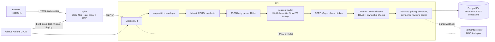
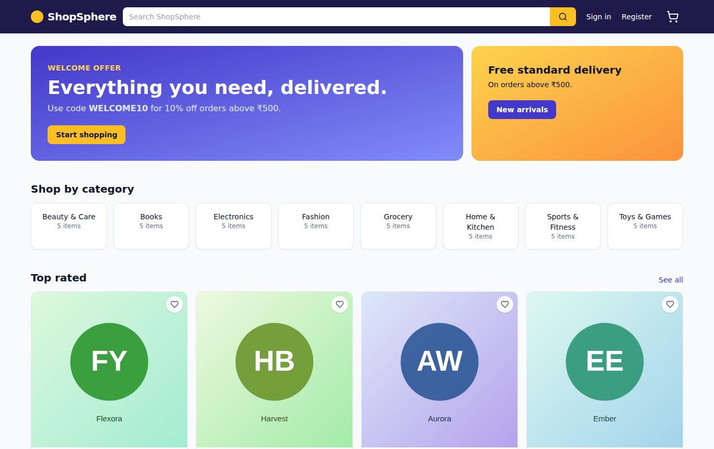
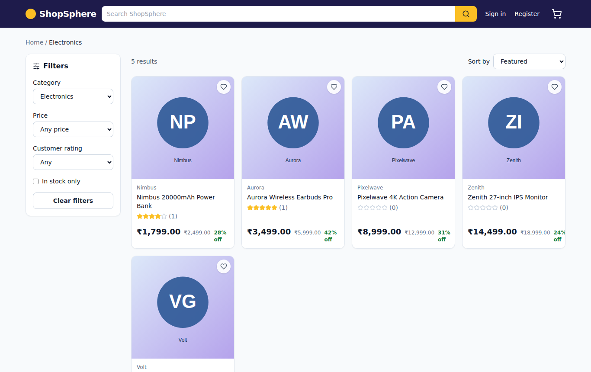
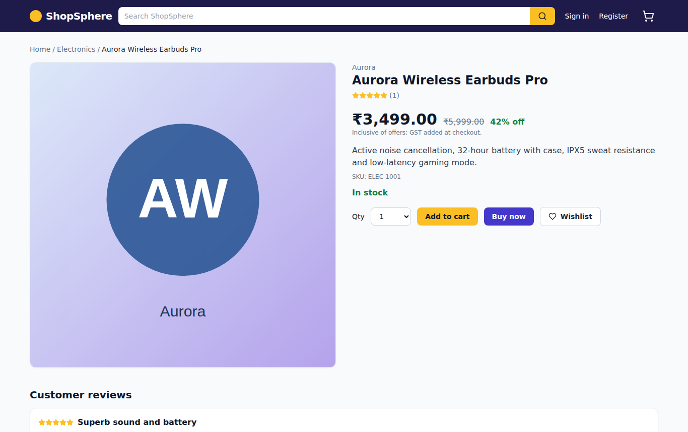
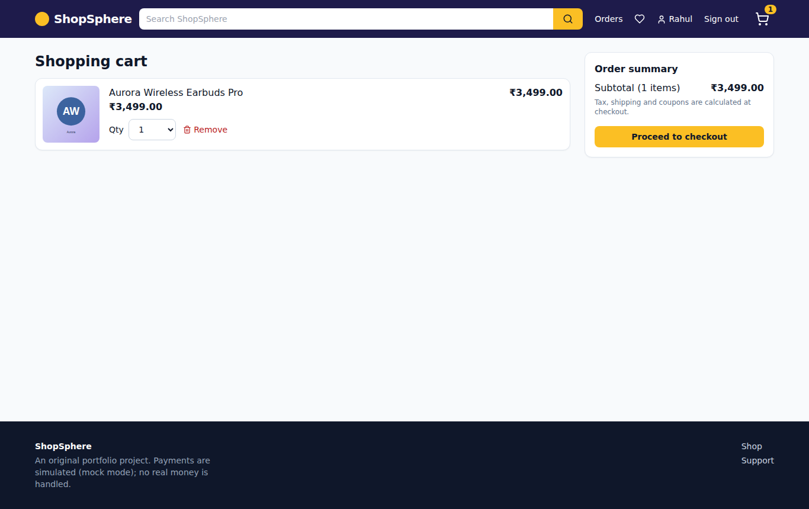
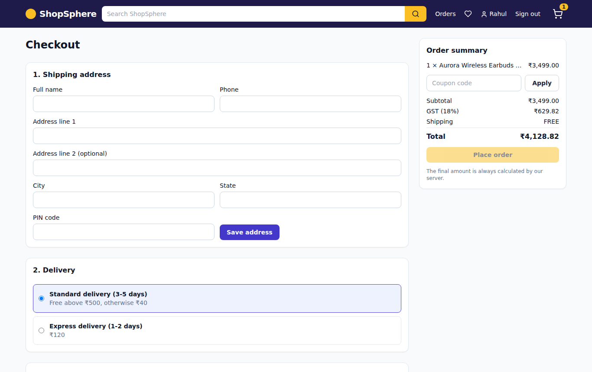
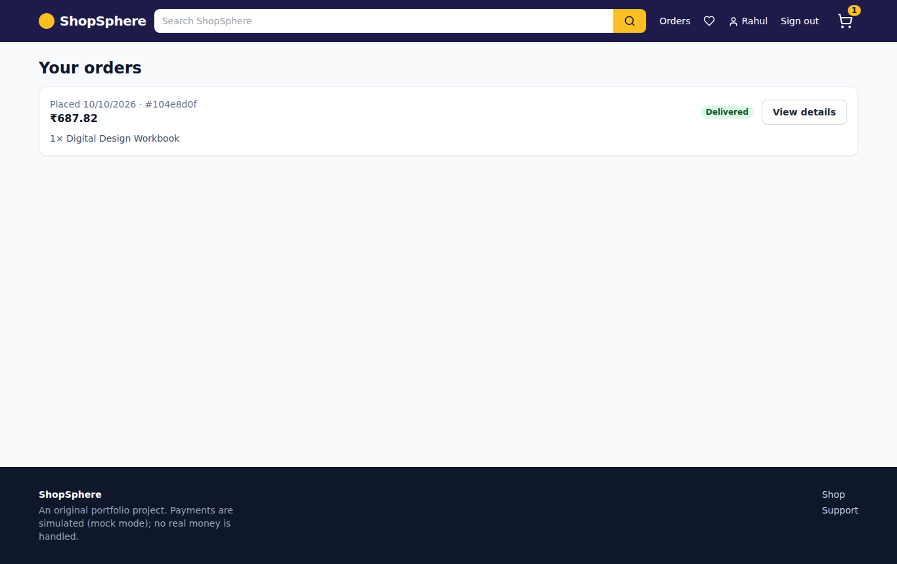
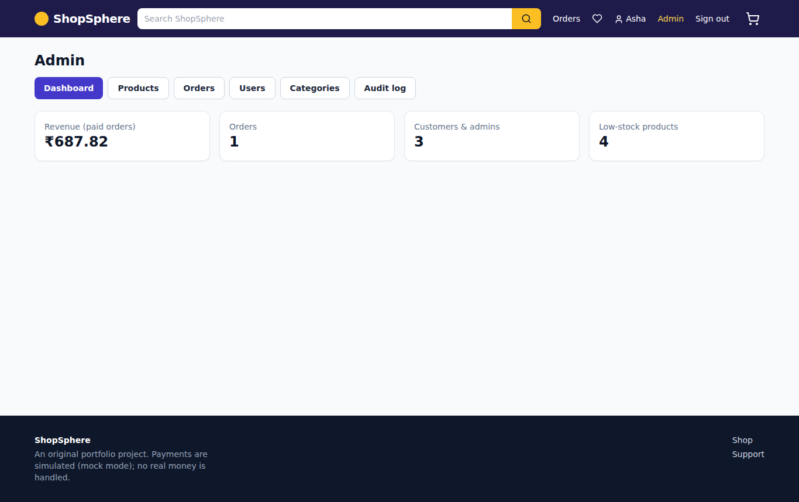
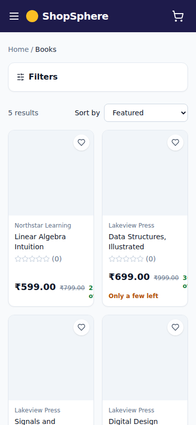

# ShopSphere

An original, Amazon-inspired full-stack e-commerce application built as a software-engineering portfolio project: React + TypeScript frontend, Express + Prisma + PostgreSQL backend, cookie-session authentication, transactional checkout with oversell protection, an admin console, automated tests, Docker and a CI/CD pipeline.

> **Honesty notes (read first).** Payments are a clearly labelled **mock provider** — no real money or card data is ever handled. Docker, Docker Compose, the GitHub Actions workflows, the deployment workflow and `prisma migrate` could **not be executed** in the environment where this was authored. Everything else listed in [docs/testing.md](docs/testing.md) was actually run. See [Known limitations](#known-limitations).

## Contents

[Features](#features) · [Architecture](#architecture) · [Tech stack](#technology-stack) · [Repository layout](#repository-structure) · [Quick start](#quick-start) · [Environment](#environment-variables) · [Database](#database) · [API docs](#api-documentation) · [Tests](#tests) · [Docker](#docker) · [CI/CD](#cicd) · [Deployment](#deployment) · [Demo accounts](#demo-accounts) · [Security](#security-features) · [Limitations](#known-limitations) · [Troubleshooting](#troubleshooting) · [Screenshots](#screenshots)

## Features

**Customer:** home page with promo banners, categories and recommendations · product listing with search, category, price range, rating and stock filters, sorting and pagination · product details with gallery, SKU, stock state, reviews and related products · registration, email verification, login/logout, forgot/reset password · cart with server-side stock validation · checkout (address, delivery speed, coupon, server-calculated totals) · order history and tracking timeline · reviews restricted to customers with a **delivered** order · wishlist · address book, profile, password change · support form · responsive UI with accessibility basics (skip link, labelled controls, live-region toasts, error boundary, skeletons, empty states).

**Admin:** dashboard stats · product create/edit/price/stock/soft-delete · category management · order list with validated status transitions · user list and role management (server-enforced; cannot demote yourself or the last admin) · audit log.

**Platform:** REST API under `/api/v1` with OpenAPI/Swagger, request IDs, structured JSON logs with redaction, uniform error format, health/readiness endpoints, rate limiting, strict CORS/CSP/Helmet, idempotent order creation, signed and idempotent payment webhooks.

## Architecture



More detail: [docs/architecture.md](docs/architecture.md).

## Technology stack

| Layer    | Choice                                                                                                          | Why                                                                     |
| -------- | --------------------------------------------------------------------------------------------------------------- | ----------------------------------------------------------------------- |
| Frontend | React 19, TypeScript, Vite, Tailwind CSS 3, React Router 7, TanStack Query, React Hook Form + Zod, lucide-react | Typed, fast, accessible components; server state cached and invalidated |
| Backend  | Node 22, Express 4, TypeScript, Zod, Pino                                                                       | Small and well understood; Zod is the single validation source          |
| Data     | PostgreSQL 16, Prisma 7 (driver adapter)                                                                        | Relational integrity, transactions, row locks; typed queries            |
| Auth     | Server-side sessions in PostgreSQL, Argon2id (`@node-rs/argon2`)                                                | Revocable sessions; no tokens in localStorage                           |
| Tests    | Vitest, Supertest, Testing Library, Playwright                                                                  | Unit, API integration (real DB), component, real-browser E2E            |
| DevOps   | Docker, Compose, nginx (unprivileged), GitHub Actions, CodeQL, Trivy, gitleaks, audit-ci                        | Reproducible builds and automated security gates                        |

Redis is intentionally **not** used (sessions live in PostgreSQL) to keep v1 simple; the rate limiter is therefore per-process (see limitations).

## Repository structure

```
apps/api/            Express API (src/modules/<domain>/{routes,service,schemas}, middleware, config, utils)
  prisma/            schema.prisma, hand-written SQL migrations, seed
  scripts/           migration fallback runner, product-image generator
  tests/             unit/ and integration/ (Supertest + real PostgreSQL)
apps/web/            React SPA (pages, components, lib) with unit/component tests
packages/shared/     Constants and pure helpers shared by API and web
e2e/                 Playwright end-to-end tests
infra/               nginx config template
.github/             workflows (ci, codeql, deploy) and dependabot
docs/                architecture, database, API guide, threat model, deployment, CI/CD, testing, status, screenshots
docker-compose.yml   db + migrate + api + web (+ optional seed)
```

## Quick start

**Prerequisites:** Node.js ≥ 22.12, npm ≥ 10, PostgreSQL 16 (or Docker), a browser. For E2E: `npx playwright install chromium`.

### Option A — Docker (one command; unverified)

```bash
cp .env.example .env            # edit POSTGRES_PASSWORD, PAYMENT_WEBHOOK_SECRET, SEED_DEMO_PASSWORD
docker compose up --build       # db -> migrate -> api -> web
docker compose --profile seed run --rm seed   # optional demo data
# open http://localhost:8080
```

### Option B — Without Docker (this path was tested)

```bash
# 1) Database (example)
createuser --pwprompt shopsphere && createdb -O shopsphere shopsphere && createdb -O shopsphere shopsphere_test

# 2) Configure and install
cp .env.example apps/api/.env   # edit DATABASE_URL, TEST_DATABASE_URL, PAYMENT_WEBHOOK_SECRET, SEED_DEMO_PASSWORD
npm ci

# 3) Prisma client + schema + data
npm run build:shared
npm run generate
npm run db:migrate              # prisma migrate deploy
#   if Prisma's engine binary cannot be downloaded: npm run db:migrate:sql -w @shopsphere/api
npm run db:seed

# 4) Run
npm run dev:api                 # http://localhost:4000   (Swagger UI: /api/v1/docs)
npm run dev:web                 # http://localhost:5173   (Vite proxies /api -> :4000)
```

In development, verification and password-reset emails are captured in memory: open `http://localhost:5173/api/v1/dev/outbox` to copy the links. Product images are generated SVGs already committed under `apps/web/public/products`; regenerate with `npx tsx apps/api/scripts/generate-images.ts`.

## Environment variables

See [.env.example](.env.example) (placeholders only). The API validates its environment at startup and **refuses to boot** in production with dev-only conveniences enabled.

| Variable                 | Purpose                                                    | Notes                                                       |
| ------------------------ | ---------------------------------------------------------- | ----------------------------------------------------------- |
| `NODE_ENV`               | `development` / `test` / `production`                      | Production enables extra startup checks                     |
| `PORT`                   | API port (default 4000)                                    |                                                             |
| `DATABASE_URL`           | PostgreSQL connection string                               | Use a least-privilege (no DDL) role in production           |
| `TEST_DATABASE_URL`      | Database for integration tests                             | Name must contain `test`; tests wipe it                     |
| `CORS_ORIGINS`           | Comma-separated exact browser origins                      | Also used for the CSRF Origin check                         |
| `APP_URL`                | Public web URL used in emailed links                       |                                                             |
| `COOKIE_SECURE`          | `true` in production (HTTPS only, `__Host-` cookie prefix) | Must be `true` when `NODE_ENV=production`                   |
| `SESSION_TTL_HOURS`      | Absolute session lifetime (default 168)                    | A 24 h idle timeout is also enforced                        |
| `PAYMENT_PROVIDER`       | `mock` (only supported value)                              |                                                             |
| `PAYMENT_WEBHOOK_SECRET` | HMAC secret for webhooks (≥ 32 chars)                      | `openssl rand -hex 32`; placeholders rejected in production |
| `ENABLE_DEV_OUTBOX`      | Exposes `/api/v1/dev/outbox`                               | **Must be `false` in production** (enforced)                |
| `ENABLE_DOCS`            | Serve Swagger UI                                           | Off by default in production                                |
| `TRUST_PROXY`            | Number of reverse proxies in front of the API              | Needed for correct client IPs and rate limiting             |
| `LOG_LEVEL`              | pino level                                                 |                                                             |
| `SEED_DEMO_PASSWORD`     | Password for seeded demo accounts                          | Seed refuses to run in production                           |
| `POSTGRES_*`, `WEB_PORT` | docker compose only                                        |                                                             |

## Database

22 relational objects: `User, Session, EmailVerificationToken, PasswordResetToken, Address, Category, Product, ProductImage, Inventory, Cart, CartItem, WishlistItem, Coupon, Order, OrderItem, OrderStatusHistory, Payment, WebhookEvent, Review, AuditLog, SupportMessage` plus enums. Money is **integer paise**; UUID primary keys; unique email/SKU/slug; CHECK constraints (non-negative stock, valid rating/price/quantity); every order item stores a snapshot of product name, SKU and price. See [docs/database-design.md](docs/database-design.md).

```bash
npm run db:migrate                          # prisma migrate deploy
npm run db:seed                             # idempotent demo data
npm run db:drift-check -w @shopsphere/api   # schema.prisma vs migrations (run in CI)
```

## API documentation

Swagger UI at `/api/v1/docs` when `ENABLE_DOCS=true`; a written guide with examples is in [docs/api-guide.md](docs/api-guide.md). Every error has the same shape: `{ "error": { "code", "message", "requestId", "details?" } }`.

## Tests

```bash
npm run test:unit                          # API unit (20) + web component/unit (18)
npm run test:api                           # API integration vs PostgreSQL (70)
npm run test:coverage -w @shopsphere/api   # with coverage
npm run build && npm run test:e2e          # Playwright (needs: npx playwright install chromium)
npm run lint && npm run format:check && npm run typecheck
npm run audit                              # dependency audit gate
```

Exact results recorded when this repository was produced: [docs/testing.md](docs/testing.md).

## Docker

`docker compose up --build` builds multi-stage images (pinned `node:22.12.0-bookworm-slim`, `postgres:16.6-alpine`, `nginx-unprivileged:1.27-alpine`), runs the API as the non-root `node` user, runs migrations as a one-shot service, publishes only the web port, and defines health checks. **These were not built in the authoring environment**; the nginx config rendered from the same template **was** exercised by the browser suite.

## CI/CD

`ci.yml` (format, lint, typecheck, unit, API integration with a PostgreSQL service + `prisma migrate deploy` + drift check + coverage, Playwright, dependency audit, gitleaks, Trivy filesystem scan, image builds + Trivy image scan, summary), `codeql.yml`, and `deploy.yml` (Google Cloud Run via GitHub OIDC: staging after green CI on `main`, production on a published release behind an approval-protected environment). Workflow YAML is syntax-checked but **no run has happened**. Actions use version tags until you run `python3 scripts/pin-actions.py`. See [docs/ci-cd.md](docs/ci-cd.md).

## Deployment

[docs/deployment.md](docs/deployment.md) covers Cloud Run setup (Artifact Registry, Cloud SQL, Secret Manager, Workload Identity Federation, GitHub Environments), migration strategy, rollback and backups. **No deployed instance exists yet.**

## Demo accounts

Created by `npm run db:seed` (password = your `SEED_DEMO_PASSWORD`):

| Email                      | Role     | Notes                                                              |
| -------------------------- | -------- | ------------------------------------------------------------------ |
| `admin@shopsphere.test`    | ADMIN    | Admin console                                                      |
| `customer@shopsphere.test` | CUSTOMER | Has a delivered order, so can review the _Digital Design Workbook_ |
| `priya@shopsphere.test`    | CUSTOMER | Author of sample reviews                                           |

Coupons: `WELCOME10` (10% off, minimum ₹500), `FLAT200` (₹200 off, minimum ₹1,500, 100 uses).

## Security features

Argon2id password hashing · server-side revocable sessions (HttpOnly, SameSite=Lax, `__Host-` prefix when Secure, absolute and idle expiry, only a SHA-256 of the id stored) · CSRF defence in depth (JSON-only bodies, Origin allow-list, per-session token) · account-enumeration resistance · login throttling, lockout and uniform timing · single-use hashed verification/reset tokens (reset revokes all sessions) · RBAC on every admin route and ownership checks on every private resource · Zod `.strict()` validation (mass-assignment protection) · parameterised queries only · server-side pricing and transactional stock reservation · HMAC-verified, replay-limited, idempotent webhooks · Helmet, strict CSP, CORS allow-list · body size limits · log redaction · audit log · production startup guards. Details, ASVS mapping and residual risks: [SECURITY.md](SECURITY.md), [docs/threat-model.md](docs/threat-model.md).

## Known limitations

These are real gaps:

1. **Not run in the authoring environment:** Docker/Compose builds, GitHub Actions runs, the Cloud Run deployment, `prisma migrate`, the CI drift check, Trivy, CodeQL, gitleaks.
2. **Migrations were hand-written** (Prisma's engine download was blocked) and applied with a fallback runner. Run `npm run db:migrate` and `npm run db:drift-check` once to confirm they match `schema.prisma`; fix any drift with `prisma migrate dev`.
3. **No real payment provider** (mock only) and no provider refund calls (refund is a state change only).
4. **No real email transport.** Emails go to an in-memory dev outbox; in production, verification/reset emails would not be delivered until an SMTP/SES transport is added.
5. **No image upload or object storage.** Admins supply `https://` or `/products/…` image URLs.
6. **Rate limiting is per process.** Use a shared store (e.g. Redis) before running several API instances.
7. No MFA, CAPTCHA, email change, data export/erasure endpoints, coupon admin UI, product variants, category hierarchy or full-text search (it uses case-insensitive substring matching).
8. Dev-tooling advisories (Prisma CLI chain, Tailwind 3 glob helpers) are allowlisted with justification in `audit-ci.jsonc`; none ships in the runtime image or web bundle.
9. No automated or manual accessibility audit was run. E2E ran on Chromium only, and "mobile" is emulation, not a real device.
10. GitHub Action SHAs are not pinned yet (run `scripts/pin-actions.py`).

## Troubleshooting

| Symptom                                       | Fix                                                                                                                                                |
| --------------------------------------------- | -------------------------------------------------------------------------------------------------------------------------------------------------- |
| `Invalid environment configuration: ...`      | Compare `.env` with `.env.example`; the message names the variable but never prints its value                                                      |
| `ECONNREFUSED 127.0.0.1:5432`                 | PostgreSQL isn't running                                                                                                                           |
| "Refusing to reset a non-test database"       | `TEST_DATABASE_URL` must point to a database whose name contains `test`                                                                            |
| `binaries.prisma.sh` / engine download errors | Network blocks Prisma binaries: use `npm run db:migrate:sql -w @shopsphere/api`; for `prisma generate` set `PRISMA_SCHEMA_ENGINE_BINARY=/bin/true` |
| 403 `CSRF_INVALID` / `ORIGIN_NOT_ALLOWED`     | Call from an origin in `CORS_ORIGINS` and send `X-CSRF-Token` from `GET /auth/me`                                                                  |
| Verification email never arrives in dev       | Open `/api/v1/dev/outbox` (needs `ENABLE_DEV_OUTBOX=true`)                                                                                         |
| 429 `RATE_LIMITED` while testing              | Wait 15 minutes or restart the API (limits are in memory)                                                                                          |

## Screenshots

Real captures from the running app (Playwright, seeded data) are in [`docs/screenshots/`](docs/screenshots).

| Home                                  | Listing                                     | Product                                     |
| ------------------------------------- | ------------------------------------------- | ------------------------------------------- |
|  |  |  |

| Cart                                  | Checkout                                      | Orders                                    | Admin                                   | Mobile                                            |
| ------------------------------------- | --------------------------------------------- | ----------------------------------------- | --------------------------------------- | ------------------------------------------------- |
|  |  |  |  |  |

Regenerate: `npm run build && SCREENSHOTS=1 npm run test:e2e -- screenshots --project=desktop`.

## License

Educational and portfolio use. Product names and brands in the seed data are fictional.
