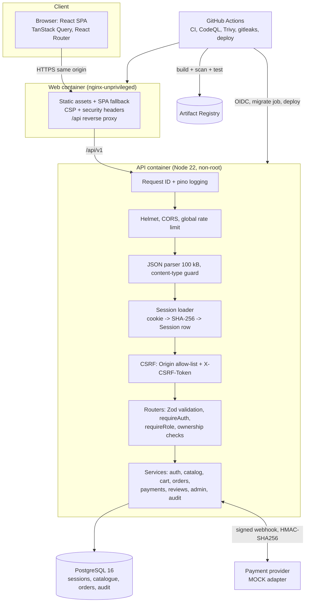
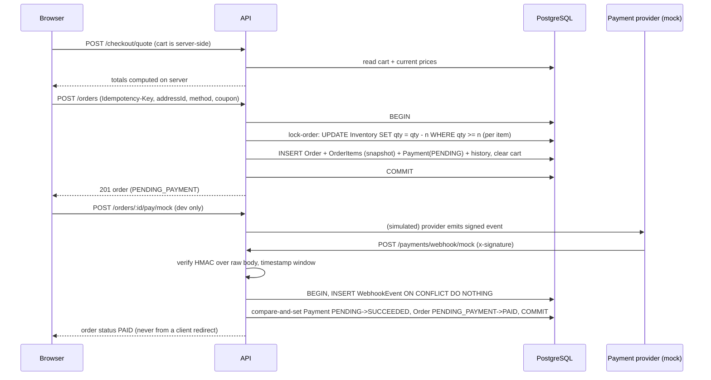

# Architecture

## System context

## Why these decisions

| Decision                                                   | Reason                                                                                                                                                                  |
| ---------------------------------------------------------- | ----------------------------------------------------------------------------------------------------------------------------------------------------------------------- |
| Server-side sessions in PostgreSQL (no JWT, no Redis)      | Instant revocation (logout, password reset, role change), no token in `localStorage`, one fewer service to run. Cost: a DB read per request (indexed on a unique hash). |
| Same-origin deployment (nginx proxies `/api`)              | Lets `SameSite=Lax` HttpOnly cookies and the CSRF design work unchanged in dev (Vite proxy) and prod; avoids wide CORS.                                                 |
| Money as integer paise                                     | No floating-point error; exact comparisons; `CHECK` constraints are simple.                                                                                             |
| Stock decrement as a conditional `UPDATE`                  | Atomic and lock-based; correct under concurrency without serialisable isolation or retries. Proven by parallel-checkout tests.                                          |
| Reserve stock at order creation, release on failure/cancel | The customer sees an order immediately and the item cannot be sold twice; unpaid orders must be cancelled (a timed auto-expiry job is a known gap).                     |
| Webhook ledger table with unique `(provider,eventId)`      | Idempotency independent of application logic; duplicates are harmless even when concurrent.                                                                             |
| Zod `.strict()` at every boundary                          | Validation and mass-assignment protection in one declaration.                                                                                                           |
| Hand-written SQL migrations in Prisma's folder format      | Prisma's engine download was blocked where this was built; CI runs `prisma migrate deploy` and a drift check to prove they match the schema.                            |
| Mock payment adapter behind the real webhook path          | The "pay" button sends a **signed event through the same handler** a provider would call, so paid-state logic is exercised honestly.                                    |

## Request lifecycle: checkout

## Module layout (API)

`src/modules/<domain>/` holds `*.routes.ts` (HTTP, validation, authorisation), `*.service.ts` (business rules and transactions) and `*.schemas.ts` (Zod). Cross-cutting code lives in `middleware/`, `config/`, `services/` (audit, mailer), `utils/`. Controllers are folded into route files (handlers are one-liners calling services) to avoid a pass-through layer; repositories are not used because Prisma already provides a typed data layer.

## Dependency summary

- **Runtime (API):** express, helmet, cors, express-rate-limit, cookie-parser, zod, pino/pino-http, `@node-rs/argon2` (prebuilt native Argon2id), `@prisma/client` + `@prisma/adapter-pg` + `pg`, swagger-ui-express.
- **Runtime (web, bundled):** react, react-dom, react-router, @tanstack/react-query, react-hook-form, @hookform/resolvers, zod, lucide-react.
- **Dev/CI:** typescript, vite, vitest, supertest, Testing Library, Playwright, ESLint, Prettier, tailwindcss, prisma CLI, audit-ci.
