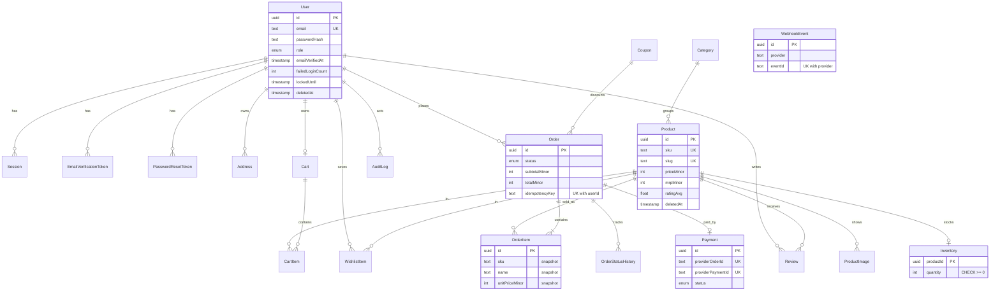

# Database design

PostgreSQL 16. Source of truth: `apps/api/prisma/schema.prisma`; SQL in `apps/api/prisma/migrations/`.

## Notes

- **Identifiers:** UUID primary keys (`gen_random_uuid()` defaults) — not guessable or sequential.
- **Money:** `INTEGER` paise everywhere (max ≈ ₹2.1 crore per amount, enforced by Zod limits). No floats.
- **Uniqueness:** `User.email`, `Product.sku`, `Product.slug`, `Category.slug`, `Coupon.code`, `Session.tokenHash`, token hashes, `Payment.providerOrderId`, `(Order.userId, idempotencyKey)`, `(Review.productId, userId)`, `(WishlistItem.userId, productId)`, `(CartItem.cartId, productId)`, `(WebhookEvent.provider, eventId)`.
- **CHECK constraints** (migration `…_constraints`): `Product.priceMinor > 0 AND mrpMinor >= priceMinor`; `Inventory.quantity >= 0`; `CartItem.quantity BETWEEN 1 AND 10`; `Review.rating BETWEEN 1 AND 5`; `OrderItem.quantity > 0 AND unitPriceMinor > 0`; `Order` totals non-negative; `Coupon.value > 0` and percent ≤ 100; `Payment.amountMinor >= 0`.
- **Indexes:** FK columns, `Product(priceMinor)`, `Product(name)`, `Order(userId, createdAt)`, `Order(status)`, `Review(productId, createdAt)`, `AuditLog(createdAt)`. Substring search (`ILIKE '%q%'`) cannot use a B-tree index — add a `pg_trgm` GIN index or full-text search for large catalogues.
- **Soft delete:** `User.deletedAt`, `Product.deletedAt`, `Address.deletedAt`. Order items keep snapshots, so deleting or editing a product never alters history. `Order → User` and `OrderItem → Product` are `RESTRICT`.
- **Denormalised aggregates:** `Product.ratingAvg/ratingCount`, recomputed in the same transaction as review create/delete.
- **Tokens and sessions:** only SHA-256 hashes are stored.

## Concurrency and transactions

| Operation                    | Strategy                                                                                                                                                                                                           |
| ---------------------------- | ------------------------------------------------------------------------------------------------------------------------------------------------------------------------------------------------------------------ |
| Checkout                     | Single transaction. Items ordered by `productId` (consistent lock order). Each item: atomic `UPDATE … WHERE quantity >= n`; zero rows ⇒ abort with `INSUFFICIENT_STOCK`. Coupon use is a conditional `UPDATE` too. |
| Order creation retry         | `(userId, idempotencyKey)` unique; a unique-violation race returns the winner's order.                                                                                                                             |
| Payment events               | `INSERT … ON CONFLICT DO NOTHING` ledger, then compare-and-set updates (`WHERE status = 'PENDING'`).                                                                                                               |
| Cancel / fail / admin cancel | Win the status transition first (`updateMany … WHERE status = X` must affect 1 row), then release stock — so stock is never released twice.                                                                        |
| Reviews                      | Insert + aggregate recompute in one transaction; unique `(productId, userId)` blocks duplicates.                                                                                                                   |

## Operations

- **Backups:** enable managed point-in-time recovery; also take a nightly logical dump (`pg_dump -Fc`) to separate storage; rehearse a restore quarterly.
- **Retention (suggested):** expired/used tokens and revoked/expired sessions — purge after 30 days; audit log — 1 year; support messages — 1 year; orders — as required by tax law (commonly 7–8 years), then anonymise personal fields. A purge job is **not** implemented.
- **Roles:** use one role for migrations (DDL) and a separate application role with `SELECT/INSERT/UPDATE/DELETE` only.
